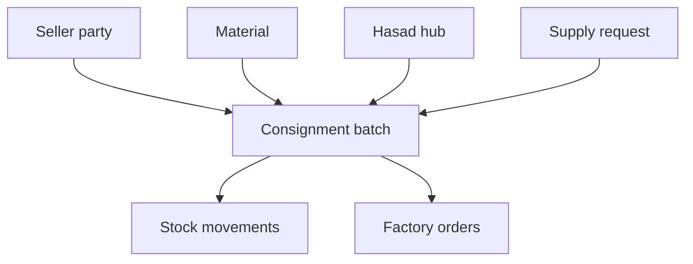
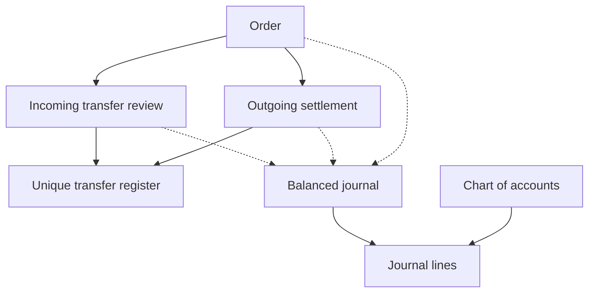
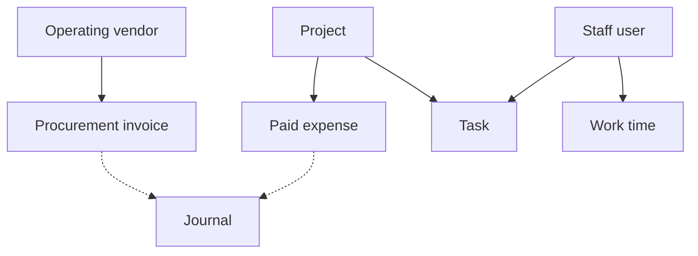

# Hasad database model

The full authoritative definition is `htdocs/database/schema.sql`. These diagrams explain private staff-side relationships; customers never receive counterparties' identity/contact records.

## Physical stock and ownership

One accepted supply request produces one source batch. Processing may produce a new batch without a source intake ID, retaining the original seller owner. Batch quantity and reserved quantity are independent balances, with a movement history.

## Orders and accounting

Solid lines describe record links; dotted lines describe application-triggered accounting events. Journals identify their source/event through a unique key. Incoming receipt confirmation holds buyer funds; fulfillment recognizes seller/carrier balances and Hasad fees separately.

## Operating purchases and projects

Procurement covers Hasad operating costs, not ownership of agricultural consignments. Project expenses contribute to the project's used budget. Support users can update only tasks assigned to them.

## Table groups

| Group | Tables |
|---|---|
| Configuration and identity | `settings`, `users`, `rate_events`, `otp_challenges` |
| CRM and source definitions | `parties`, `hubs`, `materials`, `supply_requests` |
| Stock and sales | `batches`, `orders`, `stock_movements`, `shipments` |
| Payment and accounting | `payments`, `transfer_register`, `settlements`, `accounts`, `journals`, `journal_lines` |
| Operational ERP | `procurement`, `projects`, `expenses`, `tasks`, `attendance`, `production_jobs` |
| Customer service and traceability | `tickets`, `audit_log` |

## Important data rules

- Nullable phone/email fields let staff authenticate by email and customers by phone without shared-password customer accounts.
- Guest intake remains separate until phone-owner verification or administrative inspection establishes the relevant owner relationship.
- Materials and parties are reference entities; public listing views deliberately omit the seller record and internal report.
- Receipt files are private filesystem objects whose random paths and verified MIME are recorded in `payments`.
- Quantities use `BIGINT` grams; monetary values use `BIGINT` piastres. Avoid changing them to floating-point columns.
- `batches` checks enforce `0 <= reserved_g <= quantity_g`.
- `journal_lines` checks require a positive amount on exactly one side.
- A unique `(source, source_id, event)` prevents double posting the same accounting event.
- Unique transfer references prevent re-accounting the same receipt/payout across supported workflows.
- Daily staff time uses a unique `(user_id, work_date)`; a correction updates that day's record and leaves an audit event.
- Foreign keys preserve ownership and transaction links. Removing business records requires a deliberate retention/backup strategy rather than deleting related accounting history through the customer interface.
